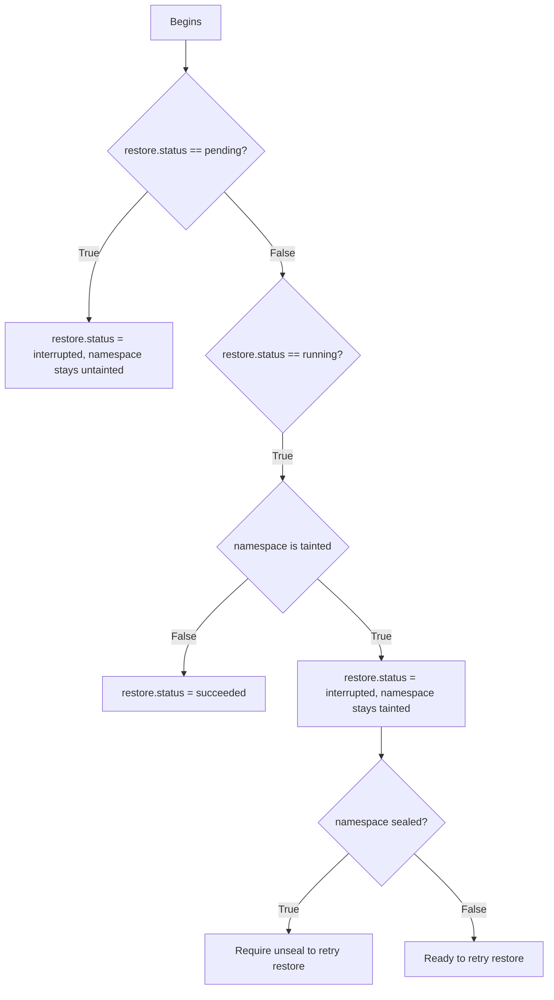

# Namespace Backup

## Summary
The RFC outlines a proposal to introduce a backup/restore mechanism for
transactional backends, using namespace as a segmentation unit. This is aimed at
giving OpenBao tenants more control: they can choose when to back up and restore
their data without having to escalate this to an admin who can perform an
instance-wide Raft snapshot.

## Problem Statement
OpenBao already has several methods for backup/restore on an instance level, e.g.
Raft snapshots, PostgreSQL backups. However, this backup operation can only be
carried out by a user either authorized with the correct policy on the root
namespace or correct access to the database behind the storage backend. This
carries some limitations in a multi-tenancy setup: users in charge of
sub-namespaces do not have an option to back up and restore their data at will.

## User-facing description
### Creating a backup
A backup operation can be started via a call to `GET
sys/namespaces/<namespace-name>/backup`, called via the parent namespace
context. The user gets a backup archive back as a response. Users are authorized
with a `sudo` grant on this path.

The backup archive contains data from the target namespace only (minus run-time
state like tokens or leases), meaning no child namespace is included. If
necessary, child namespaces can be backed up separately.

A sealable namespace's backup also contains its seal configuration (encrypted by
the next sealable parent's barrier) along with its root key (encrypted by the
unseal key) and barrier key ring (encrypted by the root key).

Backup is allowed on any namespace, even sealed namespaces.

### Restoring a backup
With the backup archive file available, users can initiate restores by making a
call to `POST sys/namespaces/<namespace>/restore` from the parent namespace,
passing the backup archive file as `data-binary`, similar to [Raft snapshot
restore](https://openbao.org/docs/api/system/storage/raft/#sample-request-6). A
`sudo` grant is required for this call.

By initiating a restore on the namespace, the namespace is tainted and its
tokens and leases revoked before the actual restore can begin. A successful
restore brings the persistent state of the namespace back to that of the backup
archive, meaning new data/mounts created after the backup are removed.

A restore does not rewrite seal config and encryption key materials.

Once started, the restore progress can be monitored by this API call:

```
GET sys/namespaces/<namespace>/restore/status

{
  "status": "pending",
  "backup_id": "...",
  "error": "..."
}
```

* `status` can be one of these states:
  * `pending`: the restore is initiated and the backup archive is being checked for
    validity.
  * `running`: the restore is being carried out.
  * `interrupted`: the restore operation failed to be finished, a retry is
    possible via `POST sys/namespaces/<namespace>/restore`. This state can be
    the result of a restore being interrupted by a crash for example.
  * `rejected`: the restore is rejected, the namespace is unchanged. This can happen
    if the backup archive is malformed.
  * `failed`: the restore failed and cannot be retried. The namespace must be
    restored from a different backup or deleted.
  * `succeeded`: the restore finished successfully.

Restoring is only possible on existing namespaces that are either non-sealable
or unsealed. Users can only restore to the exact namespace that the backup was
created from, no namespace transplantation is possible.

During the restore, the namespace remains inaccessible and requests to delete
the namespace under restore are rejected.

For sealable namespaces, if a restore is interrupted by a crash, the namespace
needs to be unsealed again upon restart to retry.

## Technical Description
### Backup format
Currently, the Raft snapshot format is defined as a gzip-compressed tar with these files:
* `meta.json`: metadata (index, term, size etc..) defined in `raft.SnapshotMeta`
* `state.bin`: array of binary protobuf `pb.StorageEntry` containing `{key,
  value, seal_wrap}`
* `SHA256SUMS`: sha256 hash of `meta.json` and `state.bin`.
* `SHA256SUMS.sealed`: `SHA256SUMS` encrypted with the unseal key.

Thanks to `state.bin` consisting of a list of storage entries, this format can
mostly be reused (albeit in a different type) for namespace backups, with
changes in `meta.json` and `SHA256SUMS.sealed`.

`meta.json` contains information about this namespace, for example
```
{
  "backup_id": "...",
  "namespace_uuid": "...",
  "namespace_path": "...",
  "openbao_version": "...",
  "format_version": "...",
  "created_at": "..."
}
```

`SHA256SUMS.sealed` should be `SHA256SUMS` encrypted with the barrier key ring
of the root namespace. This has a couple of advantages:
* Prevent tampering of the backup archive (unless by a user with access to the
  root barrier key).
* Prevent restoring from a backup made in another cluster, because the root
  barrier key would be different.
* Allow the backup to survive unseal key/root key/barrier key rotation.

The `pb.StorageEntry` within `state.bin` are taken from the storage `Physical`
layer. This means that all the entries are already encrypted.

### Backup process
The backup makes sure to capture a stable snapshot of the namespace by using a
read only transaction, the steps are:
* Start a read transaction.
* Prepare `meta.json` and its sha256 hash for `SHA256SUMS`.
* Walk through the physical storage entries eligible to be backed up.
* With each entry, continuously calculate the sha256 hash for `state.bin` in
  `SHA256SUMS` and write the entry to a temporary file.
* Close the transaction.
* Encrypt `SHA256SUMS` with the root's barrier to create `SHA256SUMS.sealed`.
* Assemble the backup archive from `meta.json`, `SHA256SUMS`,
  `SHA256SUMS.sealed` and the temporary file.
* Stream the backup archive to the client and delete it on the server side.

There's two types of storage entries eligible for backup, all are relative to
`namespaces/<namespace uuid>`:
* Namespace seal config and encryption materials, only for sealable namespaces:
  * `core/seal-config`: seal configuration.
  * `core/keyring`, `core/root-key`, `core/shamir-kek`, `core/hsm/barrier-unseal-keys`.
* Namespace data:
  * `core/mounts/*`, `core/local-mounts/*`, `core/auth/*`, `core/local-auth/*`: the mount tables.
  * `logical/*/**` except cubbyhole: logical backend storages
  * `auth/*/**`: auth backend storages.
  * `sys/policy/*`: policies
  * `sys/token/roles/*`: token roles
  * `sys/login-mfa/**`: MFA configuration
  * `sys/mfa/totpkeys/**`
  * `sys/quotas/`
  * Password policy, external keys, workflows...

### Restore process
Restore operations can only be done from the active node. Standby nodes always
forward the restore request to the active node.

The namespace entry gets a new, optional `restore` field storing the status of
the restore operation with this content:
```
{
  "restore": {
    "status": "...",
    "backup_id": "...",
    "error": "..."
  }
}
```

The process for restoring is as follows:
* Receive the backup archive, write the archive into a temporary file on disk.
* Set `backup_id` to the one from the archive, set `restore.status` to `pending`.
* Check the validity of the backup archive, if the archive is not valid, set 
  `restore.status` to `rejected`:
  * Decrypt `SHA256SUMS.sealed` with the root namespace's barrier.
  * Check `SHA256SUMS`(and the decrypted `SHA256SUMS.sealed`) for validity against 
    a self calculated hash from `meta.json` and `state.bin`.
  * Check `meta.json` for matching namespace UUID and path to the target namespace.
  * Check `meta.json` for version compatibility.
  * Use live barrier key ring to decrypt the namespace data in the backup.
  * Check if the mount entries' UUIDs match the mount storages and that the
    plugins for them exist. Also check for UUID uniqueness against other
    namespaces.
* Taint the namespace. This takes the namespace offline for users. In the same
  write transaction, set `restore.status` to `running`.
* Revoke leases and tokens.
* Unload the namespace.
* Wipe the entries under the prefixes eligible for backups, skipping entries in the
  encryption material group: `core/seal-config`, `core/keyring`, `core/root-key`, 
  `core/shamir-kek`, `core/hsm/barrier-unseal-keys`.
* Write the entries from the backup into storage, skipping entries in the
  encryption material group.
* Delete the temporary backup file.
* Reload the tainted namespace (this needs implementation, but there's precedent
  of something similar in `clearNamespaceResources`). If this fails, set
  `restore.status` to `failed` and the namespace stays tainted.
* Untaint the namespace.
* Set `restore.status` to `succeeded`.

### Recover from interruptions during restores

A restore can be interrupted by a couple of events e.g., a crash, a leader
change. The active node detects upon startup or when a parent namespace is
loaded/unsealed if a restore operation has been interrupted and proceed based on
the status of the `restore` and `tainted` field.



## Future work
The mechanism proposed in the RFC can be extended further in the future to
support more use cases and improve robustness.

### Recreating a deleted namespace
Since the backup archive contains the seal configuration and encryption
materials, it can technically be used to recreate a namespace that has been
deleted.

More design work is needed to support this use case because OpenBao doesn't
have access to the target namespace's barrier key if the namespace is sealable,
making backup verification more complex.

### Atomic switch with per-namespace storage backend
With support for [Per-namespace Storage
Backends](https://github.com/openbao/openbao/pull/4171), the restore process can
be made more resilient to crashes. The restore operation could write the backup
into a separate partition and afterwards carry out an atomic switch from the
namespace's original partition to this new partition. This way, the namespace
never ends up in a half-restored state.

### Selective Backup/Restore
The backup archive format is flexible enough to allow for a per-mount selection
in a namespace. For example, a backup request can look like this:
```
POST sys/namespaces/<namespace>/backup 
{
  "secrets": ["pki/", "kv/"],
  "auth": ["userpass/", "oidc/"],
  "include_encryption_materials": true,
  "include_settings": true
}
```
* `secrets` contains the secret mounts to be backed up. Defaults to `["*"]`.
* `auth` contains the auth mounts to be backed up. Defaults to `["*"]`.
* `include_encryption_materials` denotes if the namespace seal configuration, root
  key and barrier key ring is included in the back up.
* `include_settings` denotes if the namespace settings should be included in the 
  backup. This includes policies, identities, external keys, workflows, mfa...
  Defaults to `true`.

The same parameters can be included in the restore request to allow for
selective restore. A small tool/binary can be supplied to the user to inspect a
backup archive offline.

## Rationale and alternatives
Creating backups from the physical ciphertext allows backup/restore to be done
while preserving storage identities and avoids the need for data re-encryption.
This comes at the cost of portability: no transplantation across
namespaces/cluster is possible. However, this is suitable to support the use
case of tenants backing up/restoring the namespaces that they are responsible
for. Namespace transplantation can be made possible via [Namespace
Transfer](https://github.com/openbao/openbao/issues/1569)

Even though they are not strictly needed to restore an unsealed namespace, the 
encryption materials of the namespace (seal config, root key, barrier key ring...)
are still included in the backup archive. This is to make the backup archive forward
compatible for future use cases where they might be needed, for example, recreating
a deleted namespace.

An alternative approach is to back up the storage entries unencrypted by reading
through the barrier. This potentially allows for more flexibility and
portability (e.g. a transplant to another namespace/cluster is possible) but
would also mean that the backup is unencrypted and anyone with the backup can
read sensitive data stored within it. A way around this could be to have dedicated
backup-bound encryption keys, which introduces the need to manage another class
of encryption materials.

### Downsides
Since backup/restore both have to walk through the storage entries, the process
can take a long time for large namespaces.

The backup/restore operations both write to a temporary file, increasing disk
space usage.

If the restore fails after lease & token revocation, the leases and tokens still
end up revoked.

## Security Implications
A user with access to the root namespace's barrier key can tamper with a backup
archive offline, re-calculate `SHA256SUMS` and re-encrypt it as `SHA256SUMS.sealed`.

For namespaces with auto unseal, storing the seal configuration in the backup
allows users with access to the parent's barrier key to gain access to possibly
sensitive information within the seal config, like KMS credentials. This would
allow them to decrypt the root key and the barrier keyring of the namespace.
However, this is also true for a live OpenBao instance: anyone holding the barrier key
used by the parent namespace can decrypt the seal config of a child namespace.

A restore undoes stored revocation state (CRL, revoked login credentials etc.)
introduced after the backup.

## Unresolved Questions
* The list of paths to backup is likely still incomplete. Would it be better if
  we decide on a deny list instead of an allow list?

## Related Issues
* https://github.com/openbao/openbao/issues/1569
* https://github.com/orgs/openbao/discussions/3986

## Proof of Concept
TBD